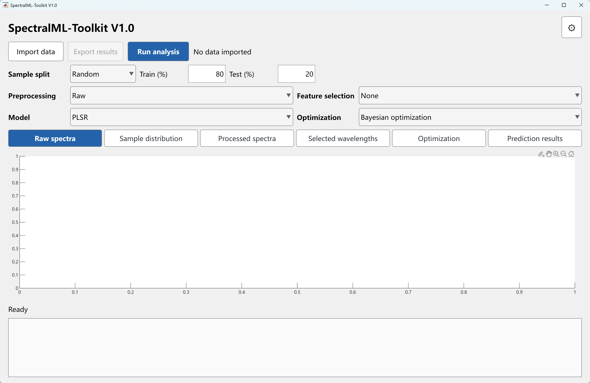
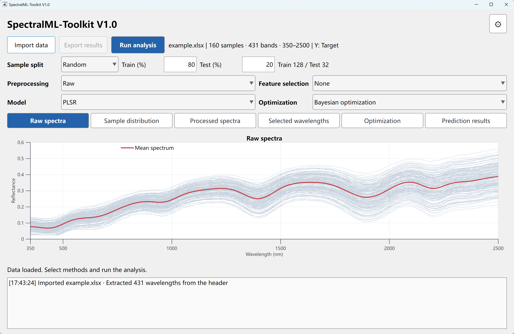
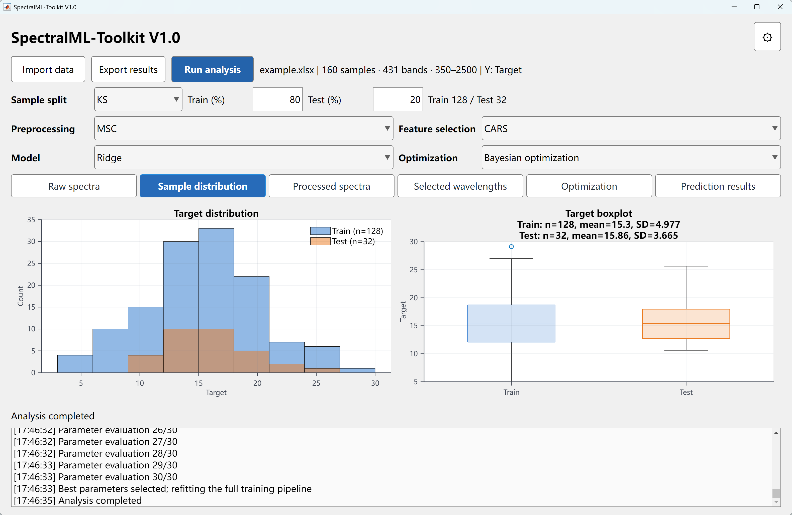
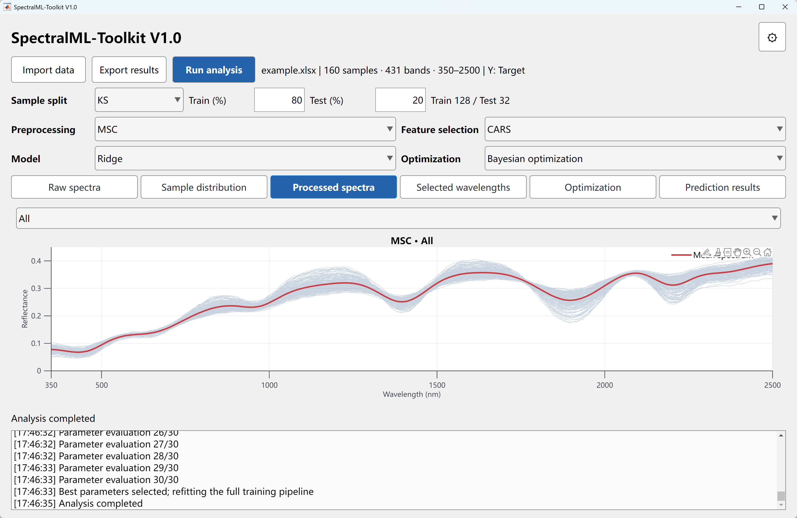
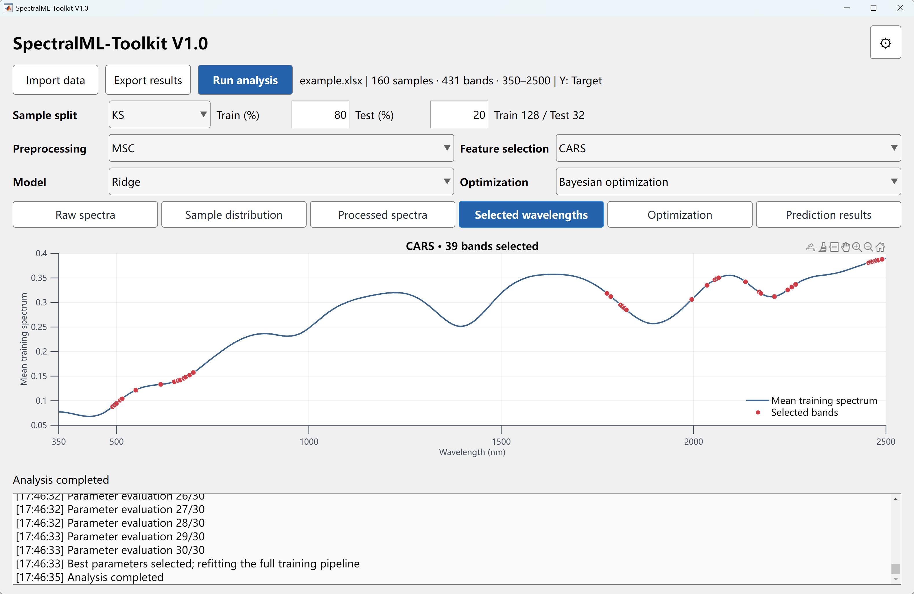
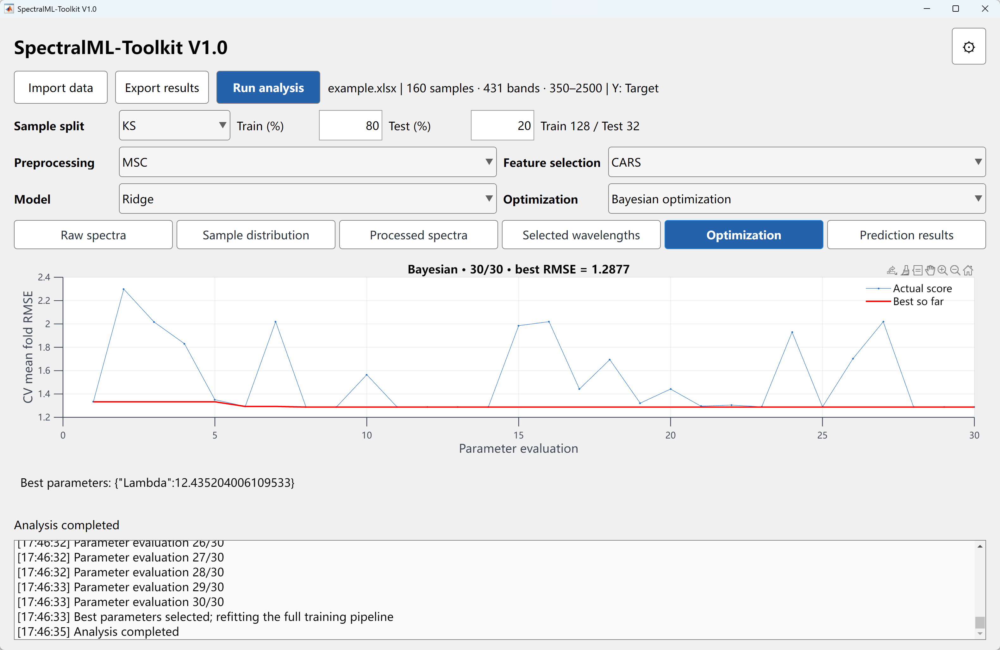
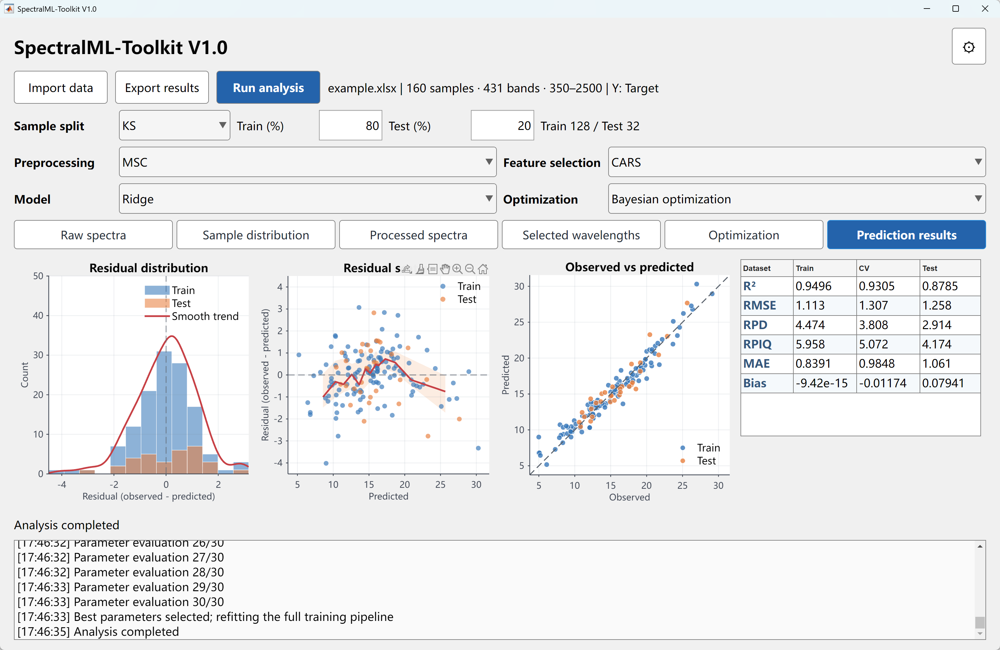
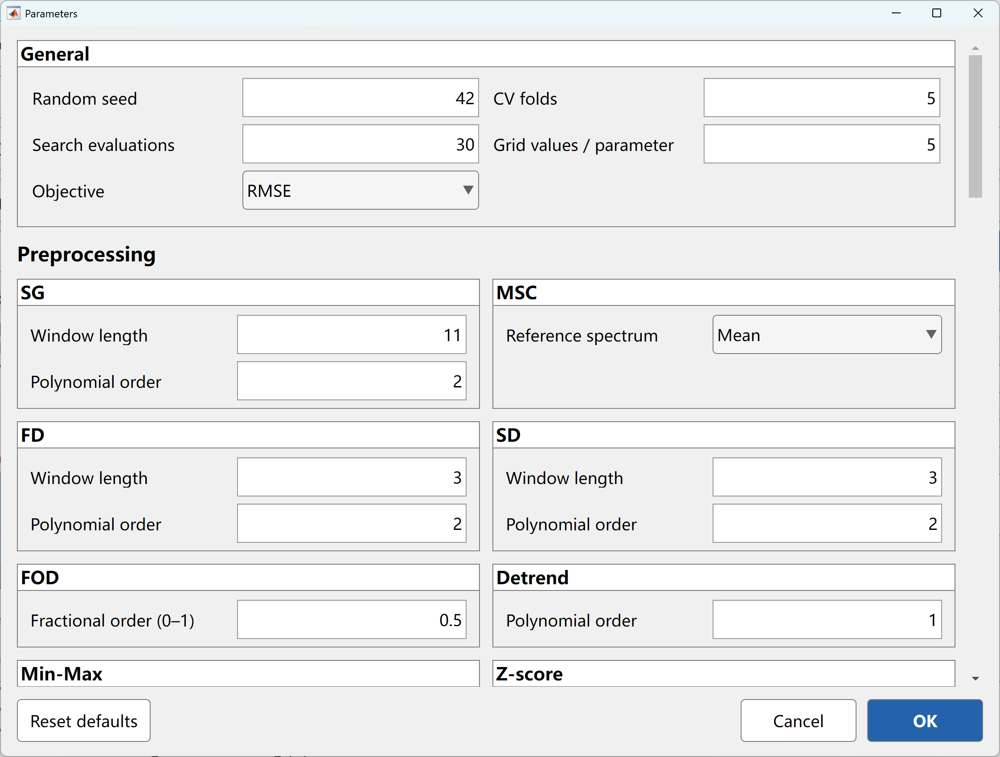

# SpectralML-Toolkit

A MATLAB desktop toolkit for spectral preprocessing, wavelength selection, regression modeling, and prediction diagnostics.

[简体中文](README.zh-CN.md) · [Installation](docs/INSTALLATION.md) · [Algorithms](docs/ALGORITHMS.md) · [Preprocessing and PCR](docs/PREPROCESSING_PCR.md)


# SpectralML-Toolkit V1.0

**A MATLAB-based graphical toolbox for spectral preprocessing, feature selection, regression modeling, and hyperparameter optimization.**

SpectralML-Toolkit is an open-source MATLAB application designed for spectral data analysis and quantitative prediction. It provides an integrated graphical interface for researchers working with hyperspectral, near-infrared (NIR), and other spectroscopic datasets.

The toolkit combines commonly used spectral analysis methods with machine learning algorithms, allowing users to build, optimize, evaluate, and visualize regression models within a single application.

## Key Features

- **Data Import:** Import spectral datasets and identify wavelength information.
- **Sample Splitting:** Divide datasets into training and testing subsets using configurable splitting methods and ratios.
- **Spectral Preprocessing:** Apply spectral preprocessing and transformation methods.
- **Feature Selection:** Select informative wavelengths to reduce spectral dimensionality.
- **Regression Modeling:** Build and evaluate machine learning regression models.
- **Hyperparameter Optimization:** Support Grid Search, Random Search, and Bayesian Optimization.
- **Model Evaluation:** Assess model performance using R², RMSE, RPD, RPIQ, MAE, and Bias.
- **Visualization:** Display spectral curves, sample distributions, selected wavelengths, optimization progress, and prediction results.
- **Result Export:** Export analysis outputs for further research.

## Software Screenshots

### 1. Main Interface

The main graphical interface of SpectralML-Toolkit.



### 2. Raw Spectra

Visualization of the imported spectral dataset and its mean spectrum.



### 3. Sample Distribution

Visualization of the target variable distributions in training and testing subsets, including histograms and boxplots.



### 4. Spectral Preprocessing

Visualization of spectral transformations and preprocessed reflectance curves.



### 5. Feature Selection

Visualization of informative wavelengths selected using spectral feature selection algorithms.



### 6. Hyperparameter Optimization

Visualization of the optimization process, including parameter evaluations and the best objective value.



### 7. Model Evaluation

Regression performance evaluation with residual distributions, observed-versus-predicted plots, and statistical metrics.



### 8. Parameter Settings

Configuration of cross-validation, optimization objectives, preprocessing parameters, and algorithm settings.



## General Workflow

1. Import spectral data.
2. Select a sample splitting strategy.
3. Choose a spectral preprocessing method.
4. Configure feature selection.
5. Select a regression model.
6. Choose a hyperparameter optimization strategy.
7. Run the analysis.
8. Evaluate and export the results.

## Implementation

- **Programming Language:** MATLAB
- **Software Version:** V1.0
- **Interface:** MATLAB-based graphical user interface
- **Application Areas:** Hyperspectral analysis, NIR spectroscopy, soil property prediction, and quantitative spectral modeling.

## Getting Started

Download or clone the repository, open the project in MATLAB, and run the main application entry point.

An example dataset is provided in the `examples` directory.

Some algorithms may require additional MATLAB toolboxes. Please check the source code and your MATLAB environment for dependencies.

## Contributing

Suggestions, bug reports, and contributions are welcome through GitHub Issues and Pull Requests.

## License

This project is distributed under the MIT License. See the LICENSE file for details.


## Features

- Import CSV, XLSX, and XLS data with wavelength detection from the original header.
- Configure one sample split, one preprocessing method, one feature selector, and one regression model per analysis.
- Tune model parameters with grid search, random search, or Bayesian optimization.
- Fit preprocessing and feature selection separately within each cross-validation training fold.
- Inspect spectra, sample distributions, selected wavelengths, search history, predictions, and residual diagnostics.
- Export tables, fitted models, configurations, search history, and 300-dpi TIFF figures with progress reporting.

| Module | Methods |
| --- | --- |
| Sample splitting | Random, KS, SPXY |
| Preprocessing | Raw, SG, SNV, MSC, FD, SD, FOD, Detrend, Min-Max, Z-score |
| Feature selection | None, CARS, VIP, UVE, SPA |
| Regression | PLSR, PCR, Ridge, SVR, RF, XGBOOST, CNN |
| Parameter search | Grid, Random, Bayesian |
| Evaluation | R², RMSE, RPD, RPIQ, MAE, Bias |

## Requirements

MATLAB R2023a/R2023b are the intended source environments. Cross-version compatibility has not been exhaustively tested.

- **Statistics and Machine Learning Toolbox**: PLSR, SVR, RF, feature selection, and Bayesian optimization.
- **Deep Learning Toolbox**: CNN.
- PCR, Ridge, the custom gradient-tree implementation, and preprocessing use native MATLAB numerical operations; the selected feature selector or optimizer may add toolbox requirements.

The interface is a programmatic MATLAB app built with `uifigure` and `uigridlayout`. Edit `SpectralML.m` in the MATLAB editor. This repository distributes source code; a standalone Windows installer is not included.

## Quick start

1. Download the repository and extract it.
2. Open MATLAB and select the extracted project root as the **Current Folder**.
3. Run:

```matlab
startSpectralML
```

4. Click **Import data** and choose `examples/example_spectra.csv`.
5. For a compact first run, select **Random → Raw → None → Ridge → Grid search**.
6. Open **Parameters**, set **Grid values / parameter** to `3`, and click **OK**.
7. Click **Run analysis**. Use **Export results** to save the completed analysis.

All adjustable algorithms are listed in one scrollable parameter window. Settings are retained when switching methods. The six plot pages are **Raw spectra**, **Sample distribution**, **Processed spectra**, **Selected wavelengths**, **Optimization**, and **Prediction results**.

## Input format

The first row contains column headers. The default layout is:

| SampleID | Target | 350 | 355 | 360 | ... |
| --- | --- | --- | --- | --- | --- |
| Sample001 | 15.562 | 0.0411 | 0.0416 | 0.0413 | ... |
| Sample002 | 14.986 | 0.0868 | 0.0864 | 0.0860 | ... |

The first column is the sample ID, the second is the response, and all remaining columns are spectral measurements. Numeric headers and explicit wavelength headers such as `350nm` are recognized. Unrecognized layouts open the import settings dialog. Wavelengths must be unique and increasing; sample IDs must be unique. Missing or nonnumeric measurements are reported rather than silently removed.

The supplied example contains **synthetic demonstration data**, not experimental observations or a performance benchmark. See [examples/README.md](examples/README.md).

## Workflow and interpretation

The application splits raw data before fitting preprocessing. During parameter search, each CV training fold fits its own preprocessor, feature selector, and model. The final pipeline is refitted on the complete training set before holdout prediction.

- CV metrics use out-of-fold predictions. The same folds select hyperparameters, so these scores are not an independent nested-CV estimate.
- SPXY uses response values when constructing the split; its holdout is target-informed.
- Residuals are **observed − predicted**. RPD uses sample standard deviation; RPIQ uses the interquartile range. Undefined display values appear as `—` and are exported as `NaN`.
- The prediction page combines Train and Test data, with a six-row comparison table for Train, CV, and Test.

## Algorithm conventions

FOD uses a **Caputo L1** discretization with fractional order in `[0,1]`, default `0.5`; it is not assumed to match a Grünwald–Letnikov implementation. Alpha zero is an explicit identity convention and alpha one is a first derivative.

`XGBOOST` is a custom native MATLAB implementation of second-order regularized gradient trees for squared-error regression. It is not the official XGBoost library or a claim of numerical equivalence. CARS and SPA also have specific implementation conventions. Read [Algorithms](docs/ALGORITHMS.md) before comparing results across packages.

## Export and model reuse

Exports include CSV/XLSX data, a configuration snapshot, the complete search history, six TIFF plot pages, `model.mat`, and `analysis_result.mat`.

```matlab
addpath(genpath(pwd));
loaded = load('path/to/model.mat', 'bundle');
prediction = predictNewSpectra(loaded.bundle, Xnew, wavelengths);
```

`Xnew` must have the original number of bands, with exactly the saved wavelength coordinates and order. The saved pipeline performs preprocessing, wavelength selection, and prediction consistently.

A command-line example is available as `demoSpectralML` after adding the project folders to the MATLAB path.

## Tests and project status

The repository includes automated tests for import rules, split coverage, training-only MSC, fold isolation, metric edge cases, and Ridge model reuse.

```matlab
addpath(genpath(pwd));
results = runtests('tests/test_spectralml.m');
table(results)
```

**Validation status:** the automated suite has not been executed for this revision. Full algorithm-combination, cross-version, and standalone-installer validation is pending. No benchmark accuracy is claimed.

## Project structure

```text
SpectralML-Toolkit/
  startSpectralML.m        Application entry point
  SpectralML.m             Main UI
  runAnalysis.m            Analysis pipeline
  predictNewSpectra.m      Saved-model prediction
  sampling/                Sample splitting
  preprocessing/           Spectral transforms
  feature_selection/       Wavelength selection
  regression/              Model training and prediction
  optimization/            Search and fold-local evaluation
  plotting/                Diagnostics and TIFF export
  ui/                      Parameter and import dialogs
  utils/                   Data, configuration, metrics, and export
  examples/                Synthetic data and usage examples
  tests/                   Automated tests
  docs/                    Installation and algorithm notes
```

## Contributing

See [CONTRIBUTING.md](CONTRIBUTING.md). Report issues with the MATLAB release, selected methods, relevant parameters, and the complete error message. A small anonymized or synthetic input helps reproduce a problem.

## License

[MIT](LICENSE).
